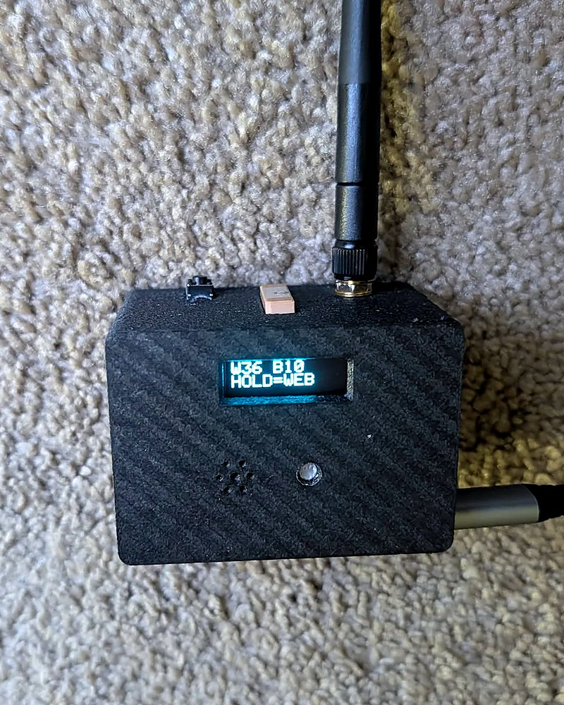
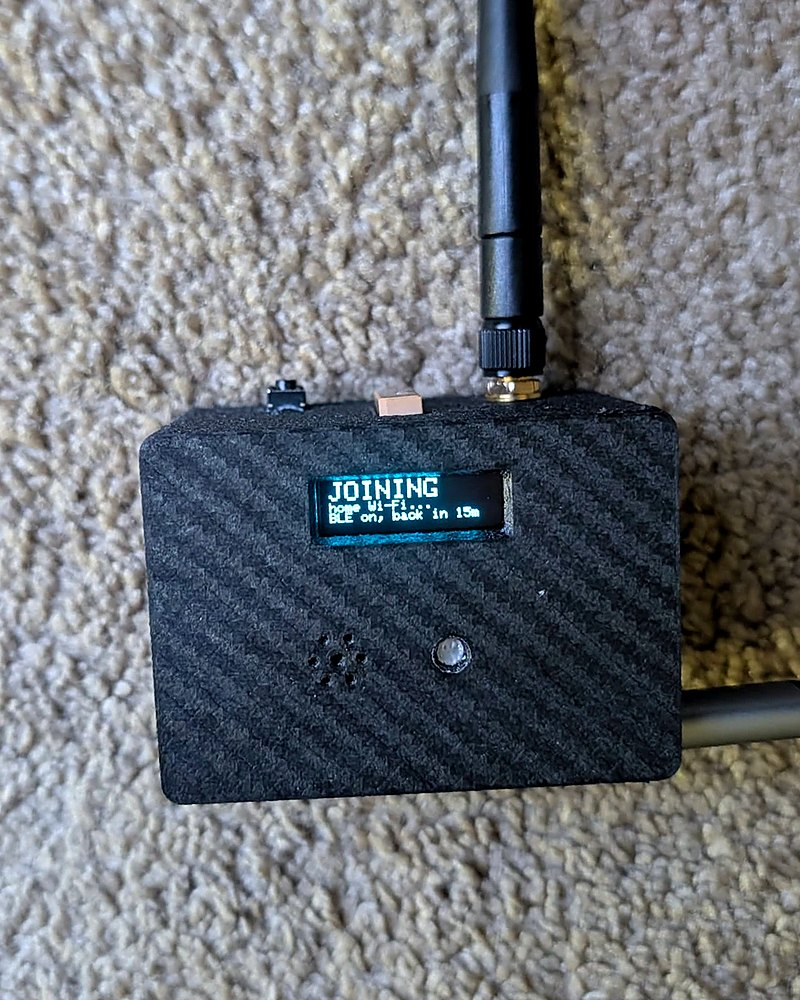

# AirWatch

A passive 2.4 GHz Wi-Fi + Bluetooth LE detector for police equipment, built on a
Seeed XIAO ESP32-S3. It sits on the dash, listens for the radios that patrol cars
and their gear carry (in-vehicle routers, body and fleet cameras, rugged laptops,
TASER/Axon Bluetooth), and beeps when one is near. It has a mark button, so you
can record what was really there; a log you can review later; optional GPS
tagging; and a web page for reading the logs and updating the firmware over Wi-Fi.

It only **listens**. It never connects to, probes or sends anything to the networks
it hears. The one exception is the web page, which needs the board's own Wi-Fi
(see [Web page](#web-page)).

<table>
  <tr>
    <td width="50%"></td>
    <td width="50%"></td>
  </tr>
  <tr>
    <td><b>Listening.</b> 36 Wi-Fi and 10 Bluetooth devices heard in the last 30 s. <code>HOLD=WEB</code> is the road-access offer during the first 15 s after power-up.</td>
    <td><b>Parked at home.</b> It is joining the home Wi-Fi for the web page. Bluetooth detection stays on, and it goes back to listening within 15 min.</td>
  </tr>
</table>

> Detections are guesses from radio signatures, not proof. Expect some false
> alarms and some misses. The mark button and the logs exist so you can tell which
> is which and tune the signatures. Check your local laws, and don't fiddle with it
> while driving.

---

## Contents

- [Features](#features)
- [Hardware](#hardware)
- [Wiring](#wiring)
- [Building and flashing](#building-and-flashing)
- [Using it](#using-it)
- [Web page](#web-page)
- [Sending logs home](#sending-logs-home)
- [Automatic firmware updates](#automatic-firmware-updates)
- [Logs](#logs)
- [Serial commands](#serial-commands)
- [The case](#the-case)
- [Tuning the signatures](#tuning-the-signatures)
- [Repository layout](#repository-layout)
- [License](#license)

---

## Features

- **Wi-Fi and Bluetooth at once.** A promiscuous Wi-Fi sniffer hops channels 1–11
  (weighted to 1/6/11) while a passive BLE scan runs alongside it.
- **Three alert levels.**
  - **POLICE (HIGH):** police-specific signatures, such as Axon / WatchGuard
    network names, TASER/Axon Bluetooth (including the `BWCDEVICE` tag Axon
    body cameras broadcast, which works even when they change address) and
    rugged-laptop WPS names.
  - **MAYBE (LOW):** in-vehicle router vendors (Cradlepoint, Sierra, Peplink) and
    broad matches.
  - **MINOR (ECHO):** traffic addressed to a matching device, and drones: the
    Remote ID most drones must broadcast (Wi-Fi and Bluetooth), and Skydio's
    addresses. One tick only, since hobby drones count too.
- **Proximity heartbeat.** For POLICE targets it ticks faster as the signal
  gets stronger. MAYBE targets beep once when they appear, then stay quiet
  (set `HEARTBEAT_MIN_TIER = TIER_LOW` to give them ticks too).
- **Fleet filter.** Fire, EMS, transit and school-bus routers are recognised by
  their network names and silenced, along with their sibling radios. A
  police-specific signature always wins.
- **Mark button.**
  - Tap means "police are there".
  - Hold for about a second means "nothing is there".
  - Each mark saves everything heard in the last 30 s, plus anything that alerted
    in the last 90 s.
  - Three quick taps mute or unmute the alerts.
- **Alert journal.** Every alert is logged automatically when it ends: when, what,
  peak signal, how long, and where.
- **GPS (optional).** Any 9600-baud NMEA module (ATGM336H, NEO-6M/M8N, GT-U7) adds
  the real time, the position and your speed in mph.
  - Positions with poor accuracy (HDOP 8 or more) are ignored.
  - Each device remembers where its signal peaked.
- **Web page.**
  - Joins your home Wi-Fi by itself when you park.
  - Or makes its own hotspot on the road.
  - Status, marks, the alert journal, a repeat-offenders view, devices, a live
    console and firmware upload.
- **Diagnostics.**
  - Reports why the board last restarted, with a crash backtrace.
  - Performance telemetry.
  - Per-signature hit counters.
  - An LED test.

## Hardware

| Part | Notes |
|---|---|
| Seeed XIAO ESP32-S3 | Built and tested with PSRAM enabled (`PSRAM=opi`). The XIAO ESP32-C3 also builds, but it is no longer the main target. |
| 2.4 GHz antenna, SMA | Through a U.FL → SMA bulkhead pigtail to the XIAO's antenna socket. |
| GPS ceramic antenna, 20 × 6 mm | Optional, comes with the ATGM336H. It sits in the case roof. |
| SSD1306 0.91" OLED, 128×32, I²C | |
| WS2812B LED | A single LED on a small round board. |
| Active buzzer, 12 mm | 3.3–5 V. Set `BUZZER_IS_PASSIVE 1` for a passive one. |
| 6×6 mm push button | Optional: the board's BOOT button also works. |
| ATGM336H GPS | Optional. Any NMEA module at 9600 baud works. |

## Wiring

Pins for the XIAO ESP32-S3. The sketch picks the right GPIO numbers from the board
you build for.

| Part | Connection | XIAO pin (GPIO) |
|---|---|---|
| Mark button | between pin and GND | D1 (GPIO2) |
| Buzzer + | buzzer − to GND | D2 (GPIO3) |
| WS2812B DIN | LED 5V to 5V, GND to GND | D3 (GPIO4) |
| OLED SDA | OLED VCC to 3V3 | D4 (GPIO5) |
| OLED SCL | | D5 (GPIO6) |
| GPS TX | GPS VCC to 3V3. GPS RX stays unconnected. | D7 (GPIO44) |
| Antenna | U.FL pigtail | antenna socket |

Notes:
- If the board reports "power dipped (brownout)" after a restart, add a 470 µF
  capacitor across 5V and GND at the XIAO, or use a better cable or charger.
- Only press BOOT once the board is powered. Holding it while you plug in starts
  the chip's USB flashing mode instead.

## Building and flashing

You need the ESP32 Arduino core 3.3.x and these libraries:
- Adafruit NeoPixel
- Adafruit GFX Library
- Adafruit SSD1306
- NimBLE-Arduino 2.x (by h2zero)

With [arduino-cli](https://arduino.github.io/arduino-cli/), install the core and
libraries:

```bash
arduino-cli core install esp32:esp32
```
```bash
arduino-cli lib install "Adafruit NeoPixel" "Adafruit GFX Library" "Adafruit SSD1306" "NimBLE-Arduino"
```

Then compile and upload (the sketch lives in the `airwatch_v2/` folder):

```bash
arduino-cli compile --fqbn esp32:esp32:XIAO_ESP32S3:PSRAM=opi airwatch_v2
```
```bash
arduino-cli upload -p /dev/ttyACM0 --fqbn esp32:esp32:XIAO_ESP32S3:PSRAM=opi airwatch_v2
```

In the Arduino IDE, choose the "XIAO_ESP32S3" board and set PSRAM to "OPI PSRAM".

**Updating over Wi-Fi.** To make a file for the web page's Firmware tab instead
of flashing over USB:

```bash
arduino-cli compile --fqbn esp32:esp32:XIAO_ESP32S3:PSRAM=opi --output-dir build airwatch_v2
```

Then upload `build/airwatch_v2.ino.bin` on the Firmware tab.

GitHub only checks that the firmware builds (with placeholder settings). It
doesn't publish firmware files, because a real build contains your Wi-Fi and
web passwords from `secrets.h`.

**Storage layout.** `partitions.csv` in the sketch folder is picked up
automatically. It gives two 2 MB firmware slots (for wireless updates) and about
3.9 MB for the logs.
- Flashing a different partition layout wipes the saved logs.
- Keep the same layout from then on.

### secrets.h (optional)

Without `secrets.h` the sketch builds and detects normally, just without the web
page. To enable the web page, copy `airwatch_v2/secrets.example.h` to
`airwatch_v2/secrets.h` and fill it in:

- `HOME_WIFI_SSID`, `HOME_WIFI_PASSWORD`: your home network (2.4 GHz).
- `HOME_WIFI_BSSID` (optional, recommended): your access points' addresses,
  separated by commas for a mesh. This stops a look-alike network with your
  name from being joined.
- `WEB_USER`, `WEB_PASSWORD`: the login for the page at home, also used for
  wireless uploads.
- `ROAD_AP_PASSWORD`: the password for the board's own hotspot (8+ characters).

`secrets.h` is listed in `.gitignore`, so it is never committed.

## Using it

### Sounds

| Sound | Meaning |
|---|---|
| short-short (at power-on) | running |
| short-short-LONG | new **POLICE** target |
| short-short | new **MAYBE** target |
| single tick | new **MINOR** target |
| ticks while in range | POLICE heartbeat: faster = closer (MAYBE: no ticks) |
| one long beep | mark saved: police are there |
| two long beeps | mark saved: nothing is there |
| three falling / rising beeps | muted / sound back on |

### Button

| Action | Result |
|---|---|
| Tap | Mark "police are there". It is saved about 0.4 s after you let go. |
| Hold about 1 s | Mark "nothing is there". |
| 3 quick taps | Mute or unmute alert sounds. Marks still beep. The setting lasts until power is cut. |
| Hold 3 s within 15 s of power-up | Road access: the board starts its own hotspot. |

A second press within 10 s saves a follow-up that adds only what is new. So if you
fumble a tap, you can correct it by holding straight away. The later mark counts.

### Screen

- **Idle, top row:** `W` and `B` are the Wi-Fi and Bluetooth devices heard in the
  last 30 s. If either sits at 0, check the antenna. `DROP n` shows briefly if
  frames were lost.
- **Idle, bottom row:** the last alert and how long ago it ended. Otherwise
  `M` is the marks saved this drive and `L` how full the log storage is.
- **Top-right corner:** a speaker with a cross means muted; a small `G` means a
  GPS fix.
- **During an alert:** POLICE / MAYBE / MINOR with the signal strength in dBm
  (closer to 0 is nearer), then what matched.

### LED

The LED shows the alert colour: red is POLICE, amber is MAYBE, dim blue is MINOR.
It brightens as the signal gets stronger. Type `led` to run a colour test.

## Web page

**At home.** When the board has heard your home network for about 3 s, it pauses
Wi-Fi listening (Bluetooth keeps running) and joins it. It goes straight to the
strongest access point it just heard, with no scan of every channel (it falls
back to a full scan if that hasn't worked in 6 s). A MAYBE alert, or a quiet
router near where you park, never delays this. A POLICE alert does only while
you're moving, for at most 2 minutes. Open
<http://airwatch.local>, or the address shown on the screen.
- It goes back to listening when any of these happens:
  - about 5 s after you drive out of range (a connection that drops and comes
    back counts as leaving unless it stays up for 10 s);
  - straight away if the GPS shows you driving (10 mph or more for 3 s);
  - when joining hasn't worked within 20 s. It tries again while parked: after
    20 s, 40 s, 80 s and so on, up to every 5 minutes;
  - when you press Exit;
  - after 15 minutes with no page requests.
- After that it stays out of home mode until you have been away for 1 minute,
  or the power is cycled. So it won't grab your Wi-Fi again at the end of the
  street. If it left because the signal faded but you pulled in after all, it
  also re-arms once home is strong (-75 dBm or better) for 10 s, or heard
  without a break for 2 minutes.
- While the GPS shows you driving, it doesn't enter home mode at all.
- Your phone must be able to reach it: client isolation on an "IoT" network or a
  separate VLAN will block the page.

**On the road.** Hold the button for 3 s within 15 s of power-up. The board starts
the hotspot `airwatch`, using your `ROAD_AP_PASSWORD`.
- Join it from your phone and tap "Sign in to network", or open
  <http://192.168.4.1>.
- If Android hangs, it is using mobile data: tap "Stay connected".

**Tabs.**
- **Status.**
- **Marks:** all marks with filters, the alert journal, and repeat offenders.
- **Devices.**
- **Console:** live output plus commands.
- **Firmware:** upload a `.bin`.

You can add notes to any mark or correct its police/nothing answer. Coordinates
link to a map.

**Wireless upload from a computer:**

```bash
arduino-cli upload -p <board IP> --protocol network --fqbn esp32:esp32:XIAO_ESP32S3:PSRAM=opi airwatch_v2
```

This is the only time the board transmits, and it does so at reduced power. Every
POST request must carry the header `X-AirWatch: 1`, so other websites can't use
your saved login. The page sends it for you.

## Sending logs home

With two extra lines in `secrets.h`, the board sends its mark log and alert
journal to a small receiver on your home network every time it joins your
home Wi-Fi.
- The receiver answers with the size and checksum of what it saved, and the
  board only deletes its copy if both match.
- If the receiver is down or the transfer breaks, the logs stay on the board and
  are sent first on the next arrival.
- The screen shows `UPLOADED`, or `UPLOAD FAIL` with two long beeps.

**1. Start the receiver** on any always-on machine (Docker host, LXC, NAS, Pi).
GitHub builds it as `ghcr.io/nullexxx/airwatch-receiver:latest`, for both PCs
and Raspberry Pis.
- **Docker Compose:** set your own token in `server/docker-compose.yml`, then
  run `docker compose up -d` in that folder.
- **Arcane, Portainer or similar:** create a new stack or project, paste the
  contents of `server/docker-compose.yml`, change the token, and deploy.

Without Docker, it runs on any machine with Python 3, and needs nothing else:

```bash
AIRWATCH_TOKEN=your-token AIRWATCH_DATA=/srv/airwatch python3 server/receiver.py
```

**2. Point the board at it** in `airwatch_v2/secrets.h`, using that machine's
address and the same token, then flash:

```c
#define UPLOAD_URL   "http://192.168.1.50:8077/upload"
#define UPLOAD_TOKEN "your-token"
```

If the console says `could not connect to the receiver`, the board can't reach
that machine. Often the board is on a separate IoT network or VLAN that isn't
allowed to connect into your main network. Allow the board's address to reach
the receiver on TCP port 8077, or run the receiver on the board's network.

Besides marks and alerts, the board also sends **background samples**: every 5
minutes while driving it silently saves a snapshot like a mark, without sound or
a button press. These are the "normal traffic" the signature finder compares
police sightings against, so it gets sharper with every drive. They're kept
out of your marks lists, cleared by ERASE, and capped at 1.5 MB between uploads.

**3. Review.** Open `http://<that machine>:8077`. The page has these tabs:

| Tab | Shows |
|---|---|
| Overview | totals: drives, marks, confirmed, missed, false alarms |
| Marks | every mark, newest first; click one to see everything heard, with vendor names, when each device was first and last heard, and how often it turns up elsewhere (click any column to sort) |
| Police sightings | for each mark where you saw police, what was heard there, ranked: rare elsewhere, strong, police-type vendor, and not home or store Wi-Fi |
| Signature finder | every logged detail (network names, names devices searched for, vendor, beacon vendor codes, WPS model, Bluetooth company / services / name) counted at police sightings versus everywhere else; the top of the list is a candidate signature, with a ready-made line to add |
| Alert journal | every alert with start and end time, plus the ones that keep coming back; click one for its signal over time and where it was first, most strongly and last heard |
| Repeat offenders | devices alerting in several marks; transmitters heard where you saw police in different places |
| Fixed routers | things that alert at the same spot on different drives (a building, not a vehicle), for you to review |
| Map | marks, alert positions and fixed routers on OpenStreetMap |
| Export for Claude | one text file for the drives you pick, vendor names filled in, to drop into a chat |

How it works underneath:
- Vendor names come from the IEEE registry and the Bluetooth company list, which
  the receiver downloads into `data/vendors/` and refreshes monthly.
- Everything is indexed in `data/airwatch.db` (SQLite). The raw uploads stay the
  source of truth: delete the database and it is rebuilt from them on the next
  start.
- The raw files are listed at `/files`.
- To protect the page with a password, set `AIRWATCH_UI_PASSWORD` in the compose
  file (any user name works).
- The board's own Marks tab links here, since after each upload it only holds
  what's new.

The logs contain GPS positions, including where you park. Keep the receiver
on your home network, and keep `server/data/` out of git (it is already in
`server/.gitignore`).

## Logs

Both logs live in the board's flash and survive power loss. You can read them on
the web page or over serial (`l` and `j`).

**Mark log (`/marks.log`).** Each mark has a header line followed by one line per
device heard. Example (shortened):

```
#MARK drive=29 mark=3 saw=POLICE type=DURING_ALERT uptime=812s heard=143 time=2026-11-21T17:42:10Z lat=… lon=… mph=34 alerting=LOW lead="Cradlepoint GW"
WIFI 00:30:44:6C:23:7D frames=BD ch=6 rssi=-71 secs=12 ago=900ms first=14000ms ssid="IBR900-37c" alerted=LOW
BLE  C8:2B:96:… addr=public rssi=-80 … cid=0B52 adv=0201…
ALERT 00:30:44:6C:23:7D tier=LOW src=WIFI rssi=-73 ch=6 … label="Cradlepoint GW" at=…,… mph=31 why=[PRF_LO|]
#NOTE drive=29 mark=3 saw=POLICE text="cruiser in the median"
```

How to read a mark:

| `saw=` (your button) | `type=` (the detector) | Meaning |
|---|---|---|
| POLICE | DURING_ALERT | hit |
| POLICE | NO_ALERT | **miss** |
| NOTHING | DURING_ALERT | **false alarm** |
| NOTHING | NO_ALERT | nothing there, nothing detected |

**Alert journal (`/alerts.log`).** One line per alert, written when the alert ends.
- It is capped at 256 KB, and the oldest half is dropped when full.
- `ongoing=yes` means the alert was still in range when it was written (reboot,
  or a full device table).
- `ended=fleet` means it was silenced mid-alert as a Fire/EMS router.
- `tl=` is its strongest signal in each second of the encounter, up to 3 minutes
  (empty = not heard that second). `from=` and `to=` are where it was first and
  last heard. The review page charts these: a single rise and fall is something
  you drove past, a long flat line is something moving with you.

## Serial commands

Use 115200 baud and type the command, then press Enter. The web Console tab
accepts the same commands.

| Command | Does |
|---|---|
| `l` / `j` | print the mark log / the alert journal |
| `ERASE` | erase the marks and the journal (must be in capitals) |
| `r` | restart and crash history |
| `s` / `d` | per-signature hit counters / tracked devices |
| `t` | toggle performance telemetry (includes GPS) |
| `0` `1` `2` `3` | channel dwell: 150 (experimental) / 250 / 500 / 1000 ms |
| `m` | mute / unmute |
| `led` | LED colour test |
| `w` / `a` / `x` | home web mode / road access / leave web mode |
| `h` | help |

## The case

`case/airwatch_case.scad` (v4.3) is an OpenSCAD design for FDM printing. It has
two parts, both PA6-CF at 0.16 mm layers, with no supports. Outside it measures
70 × 50 × 41 mm.

- **shell:** prints front-face down.
- **lid:** prints flat, outside face down. Its screw counterbores have bridging
  layers sized for 0.16 mm (`layer_h`).

The front faces the driver; the antenna and button are on top and the USB-C is on
one side. It sticks to the dash with adhesive on the bottom. `usb_right` swaps
which side the XIAO (and its USB-C opening) and the GPS go on.

What goes where:

| Part | Mounting |
|---|---|
| XIAO ESP32-S3 | Upside down on the floor, its shield stuck down with VHB tape and its headers pointing up. It sits in a 22 × 19.25 mm pocket with 9.25 mm walls. The wall is fully cut out at the front corner for the U.FL pigtail, then ramps up at 45°. The USB-C opening is a U-slot through the side wall. |
| ATGM336H GPS | On the floor with its RF shield down on VHB, in a 14 × 18.75 mm walled pocket. It has the same U.FL cutout. |
| GPS ceramic antenna (20 × 6 × 6.1 mm) | In an open pocket in the roof, standing 0.5 mm proud, held by small friction nubs. The coax goes through a notch and a pass-through in the pocket's floor. |
| 0.91" OLED | A three-sided frame behind the window, held with VHB. The header end butts against a stop and the ribbon end is open. |
| Buzzer, WS2812B | Glue-in rings behind the front holes. The LED ring is slotted for its wires. |
| 6×6 button | Glued on top near the back edge, its legs through two holes, soldered from inside. |
| SMA bulkhead | A hole in the top. |
| Lid | Three M3 screws into heat-set inserts (Ruthex RX-M3x5.7, 4.0 mm holes). |

Ready-to-print STLs of v4.3 are in `case/`: `airwatch_shell.stl` and
`airwatch_lid.stl`, already turned the way they print.

To export them yourself after changing the design, pick a part with `part` in the
file, or from a terminal:

```bash
openscad -o shell.stl -D 'part="shell"' case/airwatch_case.scad
```
```bash
openscad -o lid.stl -D 'part="lid"' case/airwatch_case.scad
```

`part="assembly"` previews the case with stand-in parts.

## Tuning the signatures

The signature tables are near the top of `airwatch_v2.ino`:

| Table | Matches |
|---|---|
| `prefixTargets` | MAC address prefixes (vendor OUIs) |
| `ssidTargets` | network names |
| `wpsTargets` | WPS device name, manufacturer and model |
| `bleCompanyTargets`, `bleServiceTargets`, `bleNameTargets` | Bluetooth |
| `ignoredSsidTargets` | Fire, EMS, transit and school fleets (silenced) |
| `quietSsidTargets` | factory-named branch or kiosk routers: silent, but saved in marks and the journal |
| `QUIET_ROUTERS` (in `secrets.h`) | routers you reviewed on the Fixed routers tab, each as `MAC@lat,lon;`. Silent (still logged) only within 300 m of that spot with a GPS fix, so one that is really in a vehicle still alerts anywhere else. Kept in `secrets.h` because the spots show where you drive |

Some signatures are built into the code rather than a table:
- the Axon body-camera tag (`AXON_BWC_TAG`);
- drone Remote ID (`BLE_REMOTE_ID_SERVICE`, `WIFI_REMOTE_ID_OUI`).

Bluetooth service IDs are matched in their short (16-bit) form and in their long
32- and 128-bit forms. A table entry can be `CAT_HIGH_CONF` (POLICE),
`CAT_LOW_CONF` (MAYBE) or `CAT_MINOR` (one tick only). Every MAC prefix in the
table has been checked against the
[IEEE registry](https://standards-oui.ieee.org/oui/oui.csv). The two marked
`Axon?` are unconfirmed and kept at MAYBE so the logs can show whether they
earn it.

Several signatures came from other open projects:
- [SquachWatch-CYD](https://github.com/skizzophrenic/SquachWatch-CYD): the Axon
  `BWCDEVICE` tag.
- [OUI-SPY](https://github.com/colonelpanichacks/oui-spy-unified-blue): Axon's
  Bluetooth IDs and the Remote ID formats.

Each mark line carries what you need to write a new signature: the full network
name, the WPS strings, the vendor codes in the beacon (`vie=`), who the device was
talking to (`peer=`) and the raw Bluetooth advert (`adv=`). Review your misses
(`saw=POLICE type=NO_ALERT`) and false alarms (`saw=NOTHING type=DURING_ALERT`) to
decide what to add or demote.

The sketch also checks the tables at boot and stops with a message if one is
malformed.

## Automatic firmware updates

Add the `airwatch-builder` service (it is already in
`server/docker-compose.yml`) and the board keeps itself up to date:

1. Every 30 minutes the builder checks this GitHub repository. When the
   firmware (`airwatch_v2/`) or your `secrets.h` has changed, it builds it on
   your server.
2. It keeps only the newest build, in `data/firmware/`.
3. Each time the board gets home, after the upload it asks the receiver for
   the newest build. If it differs from its own, it downloads it, checks the
   MD5, installs it into the spare firmware slot and reboots (`UPDATING`,
   then `UPDATED` on the screen). Any failure keeps the old firmware running.

The build name is the commit of the last firmware change plus 4 characters
from `secrets.h`, e.g. `2ae04f6.9c1d`. The Status tab on the board, the boot
log and the review page Overview all show it. A commit that only changes the
server doesn't cause an update.

**Set up once:**
- Put your `secrets.h` (the same file you flash with, including `UPLOAD_URL`
  and `UPLOAD_TOKEN`) next to the compose file, *before* starting the stack.
  Otherwise Docker creates an empty folder called `secrets.h`. In Arcane, put
  it in the project's folder on the host.
- Redeploy the stack. The first build takes a few minutes; the review page
  Overview shows `Builder: built`.
- Install that first build by hand, because the firmware on the board now
  doesn't know how to update itself yet. Download it from the Overview
  (`download` link) and upload it on the board's web page, Firmware tab. Or
  flash by USB as usual.

Your passwords are compiled into the firmware, so the builds stay on your
server. The builder image on GitHub contains only the public ESP32 toolchain.
Your `secrets.h` is mounted read-only, and the copy used for a build is
deleted afterwards. To test your own builds without them being replaced,
add `#define AUTO_UPDATE 0` to `secrets.h`.

## Repository layout

```
airwatch_v2/
  airwatch_v2.ino       the firmware (web page embedded)
  partitions.csv        storage layout (2 × 2 MB app + ~3.9 MB logs)
  secrets.example.h     copy to secrets.h for the web page
case/
  airwatch_case.scad    3D-printable case (OpenSCAD, v4.3)
  airwatch_shell.stl    ready to print: shell (front face down)
  airwatch_lid.stl      ready to print: lid (outside face down)
docs/images/            photos of the finished build
server/                 log receiver + review page (Docker or plain Python, SQLite index)
server/builder/         firmware builder for automatic updates (Docker)
```

## License

GPL-3.0. See [LICENSE](LICENSE).
